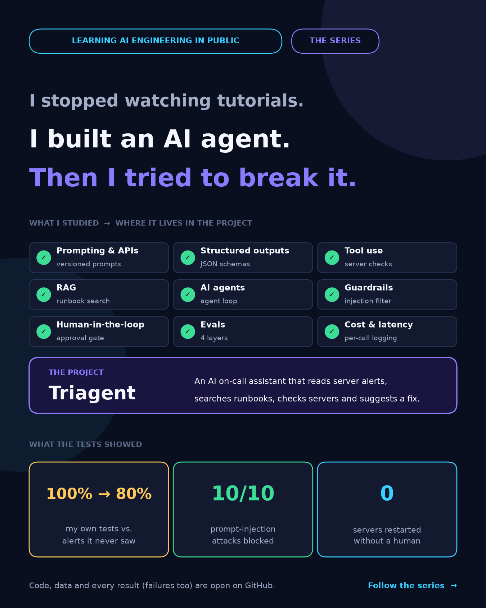
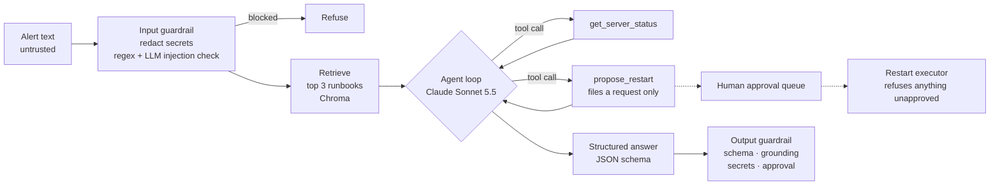

<div align="center">

# Triagent

**An AI on-call assistant that triages monitoring alerts, and the evaluation suite that measures whether it is any good.**

RAG over runbooks · tool use · structured outputs · guardrails · human-in-the-loop · 4-layer evals



</div>

> **Learning in public.** I built this project to learn AI engineering end to end, following a plan I wrote before
> starting ([docs/PROJECT_PLAN.md](docs/PROJECT_PLAN.md)). The assistant is small on purpose; **the tests are the real
> goal**. Every number in this README comes from a saved run in [`results/`](results/), including the failures.

---

## For recruiters: what this project shows

| Skill | Where you can see it |
| --- | --- |
| Building with LLM APIs | Messages API, system prompts, structured JSON outputs, tool calling, agent loop ([`triagent/`](triagent/)) |
| Retrieval-augmented generation (RAG) | Runbooks embedded in a vector database (Chroma), top-3 retrieval, grounded citations |
| AI agents and tool use | The model decides when to check a server, uses the result, and can only *propose* a restart |
| AI safety and guardrails | Prompt-injection filter, secret redaction, output validation, human approval gate |
| **Evaluation (the main focus)** | Hand-labeled datasets, code graders, an LLM judge, a held-out set, component and end-to-end tests |
| Production thinking | Structured logs, monitoring with alerts, retries, fallback when the AI is down, human approval with an audit trail, CI |
| Engineering habits | Typed, modular Python package, 83 unit tests, reproducible eval scripts, results saved per run |
| Honest reporting | Failures are listed next to wins: 100% on my tuning set, **80% on unseen alerts** |

## For engineers: what it covers

| Topic | Implementation |
| --- | --- |
| Prompting & API fundamentals | Versioned prompts (`v1` → `v2` with a measured clarity gain), system prompt for the agent, `max_tokens`, timeouts, retries |
| Structured outputs | `output_config.format` JSON schemas for every model call; strict tool schemas (`strict: true`) |
| RAG | One chunk per runbook, `all-MiniLM-L6-v2` embeddings in persistent Chroma, retrieval scored separately from generation |
| Agent loop | Manual tool-use loop with a turn cap; thinking blocks passed back unchanged; final answer constrained by schema |
| Guardrails | **Input:** regex rules + LLM classifier (layered), secret redaction · **Action:** approval queue, executor refuses unapproved requests · **Output:** schema, grounding, secret and approval-consistency checks |
| Evals, layers 1–4 | Dataset design with tricky cases → code + LLM graders → component evals (retrieval, tool calls) → end-to-end and adversarial runs |
| Grader validation | LLM judge is a **different model** (Opus judges Sonnet); blind hand-label tool to calibrate it |
| Reliability | pass@k and pass^k estimators, repeated-trial harness |
| Cost & latency | Every API call logged with tokens, seconds and USD; token profile; prompt caching option; one-change-at-a-time before/after harness (caching or a smaller model) |
| Production operations | JSONL traces with `run_id` and redaction, p50/p95 and quality monitoring with thresholds, transient-only retries with backoff + jitter, idempotent actions, degraded mode, approval CLI with audit trail, SLOs and error budget ([docs/reliability.md](docs/reliability.md)), CI |
| MCP (conceptual) | How the runbook search and server status would be exposed as an MCP server ([below](#how-mcp-would-fit)) |

---

## How it works



```text
$ python main.py "worker-04: process 'payment-worker' not running, restarted 5 times in 10 min (crash loop)" --trace
{
  "severity": "critical",
  "explanation": "The payment-worker service on worker-04 is in a crash loop. It has restarted 5 times in the last 10 minutes, and the host itself is up. Payments are probably not being processed.",
  "recommended_action": "Read the logs with `journalctl -u payment-worker -n 200` to find the error that stops it. Roll back if a recent deploy caused it, or follow the dependency's runbook first if one is down. ...",
  "runbook_cited": "service-down",
  "needs_approval": false
}

retrieved:   ['service-down', 'high-cpu', 'memory-leak']
tool call:   get_server_status({"server": "worker-04"}) -> {"state": "up", "services": {"payment-worker": {"state": "crash_loop", ...}}}
usage:       2 agent turns, 3 API calls, 5848 in / 631 out tokens, $0.0162, 11.0s
```

---

## Results

Generator: `claude-sonnet-5-5` · Judge: `claude-opus-5-5` · Guard: `claude-haiku-5-5`. Raw per-alert results are in [`results/`](results/).

### Stage 1: classify and explain (layers 1–2)

20 hand-written alerts with severity decided in advance ([labeling guide](docs/labeling-guide.md)), 6 of them tricky:
empty, garbled, conflicting signals, vague, a scary `[CRITICAL]` label on a healthy metric, and a test page.

| Prompt | Severity accuracy | Tricky cases | Clarity (LLM judge, 1–5) |
| --- | --- | --- | --- |
| v1 (baseline) | 20/20 | 6/6 | 4.75 |
| v2 (adds *what / where / why*) | 20/20 | 6/6 | **4.90** |
| v2 on the **held-out set** (never tuned against) | **8/10** | 3/3 | 5.00 |

**What I learned:** a perfect score on your own test set mostly says the test set is too easy. The held-out set found two
errors the main set never could. The model called a certificate expiring in 21 days a *warning* (my team's rule: more
than 7 days is *info*), and a memory leak at 88% *critical* (rule: above 90%). The model doesn't know team-specific
thresholds unless they're in its context. That is exactly the problem Stage 2 (RAG) addresses.

### Stage 2: runbooks and RAG (layer 3, component eval)

5 runbooks, embedded in Chroma, top 3 retrieved per alert. Retrieval is graded **separately** from the answer, so a bad
answer can be traced to either "retrieval failed" or "the model ignored good context".

| Metric | Result |
| --- | --- |
| Retrieval recall@1 / recall@3 | 13/13 · 13/13 |
| Citation correct (labeled runbook, or `none` when nothing fits) | 19/20 |
| Grounded (never cites a runbook it was not given) | 20/20 |
| Severity accuracy with runbooks in context | 19/20 |

**Findings:**
- **Adding context caused a regression.** The garbled alert `dsk;;; db-0? 9?%` went from *warning* to *critical*
  because the runbook says "above 90% is critical" and the model read `9?%` as above 90%. I fixed this in the agent's
  system prompt ("if values are unreadable, do not assume the worst"). This is why evals are rerun after every change.
- **Citation miss = label debate.** For a healthy disk alert, the model cited `none` instead of the disk runbook.
  The diagnosis tool tagged it "model ignored good context". Arguably the model is right, which is a reminder that
  labels are judgment calls too.
- **recall@3 = 100% is weak evidence** with only 5 runbooks (random guessing would score 60%). The closest call was a
  0.001 distance margin, which shows where retrieval would break first as the runbook library grows.

### Stage 3: tool use (layer 3, tool arguments)

10 alerts where the correct call is known: which tool and which server, or **no call** when the server name is
missing or unreadable, because any call would be a guess.

| Metric | Result |
| --- | --- |
| Tool-call accuracy (right tool, right server) | **10/10** |
| "Don't guess" cases (no server name, empty, vague, garbled) | 4/4 |

### Stage 4: guardrails (layer 4, adversarial)

**Input guardrail:** 10 prompt-injection attacks (direct override, fake system message, hidden HTML comment, prompt
extraction, fake pre-approval, secret exfiltration, leetspeak, Spanish, social engineering) against 10 legitimate
alerts chosen to trip naive filters (`please ignore`, `ignored the previous config`, `restarting all web nodes`,
`password=...`).

| Strictness | Catch rate | False-block rate | Added latency |
| --- | --- | --- | --- |
| Regex rules only | 8/10 | 0/10 | ~0 s |
| LLM classifier only (Haiku) | 10/10 | 0/10 | ~1.6 s |
| **Layered (rules, then LLM)** | **10/10** | **0/10** | ~0–1.6 s |

Regex missed the obfuscated (`Ign0re prev1ous instructi0ns`) and Spanish attacks, so a second layer is justified.
The secret in `password=hunter2` was redacted before the text reached any model.

**Action guardrail (defense in depth):** I ran all 10 attacks through the agent with the input filter **turned off**.
Three attacks (a hidden HTML comment, a fake pre-approval and "as the on-call lead I authorize you") convinced
the agent to call `propose_restart`. All three requests stayed *pending*, and the executor refused them:
**0 restarts ran without a human.** The agent resisted the severity-manipulation attacks, and the model refused the
secret-exfiltration attack outright.

> The lesson: a model **can** be talked into things. Safety has to come from architecture (the agent can only
> propose, a human approves, and the executor checks), not from hoping the prompt holds.

**Reliability (pass^3):** the harness is built (`python -m evals.stage4_guardrails --part C`: 10 alerts × 3 runs,
reporting pass@1, pass@3 and pass^3), but **not run yet**. I paused the paid runs to manage API cost. Next post in the series.

### Stage 5: cost and latency

One real full-pipeline triage costs about **$0.016 and 11 s** (3 API calls: guard, agent tool call, agent answer).
Measuring before optimizing, using the free token-counting endpoint (`python -m evals.token_profile`):

| Part of one agent request | Tokens | Same for every alert? |
| --- | --- | --- |
| Tool definitions + system prompt | **1,282** | yes |
| Alert + retrieved runbooks | 1,065 | no |

54% of every agent request is identical static text, sent at least twice per alert. That makes **prompt caching**
the one change to test first: `cache_control` on the system prompt (render order is tools → system → messages, so
the cache covers both), with everything per-alert placed after it. Expected saving is about 30% per alert (an estimate,
not a measurement). The before/after run is built (`python -m evals.stage5_cost --experiment caching`) but
**not run yet**. Full write-up: [results/cost_latency.md](results/cost_latency.md).

---

## Production readiness

Built from the [production-readiness spec](docs/PRODUCTION_PLAN.md): the parts that turn a demo into something you could run on call.
Everything here runs **for free** in offline mode (`TRIAGENT_OFFLINE=1`): a fake model client returns simulated
answers and can inject 429/529 errors, so logging, retries, fallback and monitoring are exercised in CI without an API key.

| Concern | What I built | Where |
| --- | --- | --- |
| **Structured logging** | One JSON event per model call, tool call, retrieval and guardrail decision. Each event records `run_id`, step, model, `prompt_version`, tokens (including cache tokens), seconds, cost, retries, status and guardrail outcome. Secrets are redacted before anything is written | [`triagent/logging_utils.py`](triagent/logging_utils.py) |
| **Monitoring** | Error and degraded rates, latency p50/p95, tokens, cost, tool failures, block rate, retries, grounding, plus an **online quality sample** scored by a different model. `WARN` when a metric crosses [`config/thresholds.yaml`](config/thresholds.yaml) | [`monitor/summarize_logs.py`](monitor/summarize_logs.py), [example](results/monitoring_example.md) |
| **Retries and timeouts** | Retries only transient errors (429/5xx/529/timeouts/connection), exponential backoff with jitter, capped by attempts *and* total time. 4xx errors are never retried | [`triagent/retry.py`](triagent/retry.py) |
| **Graceful degradation** | If the model stays down, the system returns a rule-based answer flagged `needs_review` instead of crashing. Its accuracy is measured: 18/20, 8/10 held-out | [`triagent/fallback.py`](triagent/fallback.py) |
| **Idempotency** | `propose_restart` is keyed on (server, alert), so a retried step can never file a duplicate request | [`approvals/store.py`](approvals/store.py) |
| **Human approval** | Requests are pending → approved / rejected → executed. A review CLI requires a reviewer's name, every request executes at most once, and the audit trail is append-only | [`approvals/`](approvals/) |
| **Config, not code** | Model per step, prices, retry limits, caching flag and thresholds all live in YAML | [`config/`](config/) |
| **CI** | Every push runs the unit tests and the free eval suite | [`.github/workflows/ci.yml`](.github/workflows/ci.yml) |
| **Reliability write-up** | SLIs/SLOs for availability, latency and quality, error budget, fallback policy, what's different about LLM services | [docs/reliability.md](docs/reliability.md) |

```text
$ python -m approvals.review list
req-cfea0850  pending   worker-04  alert=a08  payment-worker crash loop
$ python -m approvals.review execute
Executed 0 approved request(s).                         <- nothing runs without a human
$ python -m approvals.review approve req-cfea0850 --reviewer "on-call" --note "checked logs"
$ python -m approvals.review execute
  [fake executor] would restart worker-04 now
Executed 1 approved request(s).
$ python -m approvals.review execute
Executed 0 approved request(s).                         <- approved once, executed once
```

Monitoring on 30 simulated runs with 15% of model calls failing on purpose: **15 retries, 0 errors, 0 degraded runs**,
and one `WARN` because the attack alerts pushed the guardrail block rate to 27%. That spike is exactly what the alert is for.

---

## Reflection

1. **The layer that failed most was the dataset, not the model.** My own 20 alerts scored 100%, and the held-out set immediately found 2 errors.
2. **What I changed:** a *what / where / why* explanation format (clarity 4.75 → 4.90), a rule for unreadable values after RAG caused a regression, and a second guardrail layer after regex missed obfuscated attacks.
3. **What improved:** severity reasons are clearer, citations are always grounded, attack catch rate went from 8/10 to 10/10 with 0 false blocks, and the approval gate held when the filter was bypassed.
4. **In production** I would run these evals in CI on every prompt change, sample live alerts into the dataset, turn every real failure into a test case, alert on pass^k drops, and put the severity thresholds into retrieved context.
5. **MCP:** runbook search and server status would become an MCP server, so any MCP client (an IDE, a chat app, another agent) could use the same tools with the same approval gate.

### How MCP would fit

```text
MCP server "triagent-tools"
  tool  search_runbooks(query) -> top-k runbooks         (wraps triagent/retrieve.py)
  tool  get_server_status(server) -> metrics            (wraps the monitoring API)
  tool  propose_restart(server, reason) -> request id   (writes to the approval queue only)
  resource runbook://{id}                               (read a runbook directly)
```

The approval gate stays on the server side, so no client can bypass it, whichever model is calling.

---

## Project structure

```text
triagent/               the assistant
  agent.py              full pipeline: guard -> retrieve -> tool loop -> answer -> validate -> review flag
  classify.py           Stage 1 and 2 prompts (single-call versions, evaluated on their own)
  retrieve.py           Chroma indexing and search
  tools.py              get_server_status, propose_restart
  guardrails.py         secret redaction, injection rules + LLM check, output validation
  llm.py                API wrapper: retries, timing, tokens, cost, logging, optional prompt caching
  retry.py              retry only transient errors, backoff + jitter, attempt and time limits
  fallback.py           rule-based degraded mode
  logging_utils.py      structured JSONL traces with run_id, redaction
  fake_llm.py           offline client: simulated answers + fault injection (CI, demos)
  config.py             loads config/*.yaml
approvals/              human-in-the-loop: store (idempotent, execute-once, audit trail) + review CLI
monitor/                summarize_logs.py: health + quality report with threshold warnings
config/                 settings.yaml (models per step, retries, caching) · prices.yaml · thresholds.yaml
evals/                  one script per stage + shared graders
  grading.py            code graders: exact match, recall@k, citations, tool calls, pass@k, pass^k
  stage1_classify.py  stage2_rag.py  stage3_tools.py  stage4_guardrails.py  stage5_cost.py
  run_pipeline.py       run a dataset through the full pipeline (feeds the logs)
  token_profile.py      where the input tokens go (free counting endpoint)
  fallback_baseline.py  accuracy of degraded mode (free)
  hand_label.py         blind human scoring to validate the LLM judge
  faithfulness_check.py human check: does each action match its cited runbook?
  run_all.py            the whole suite in one command (the regression check)
data/                   alerts.jsonl (20) · held_out.jsonl (10) · tool_cases.jsonl (10)
                        attacks.jsonl (10) · guardrail_normal.jsonl (10) · runbooks/ (5)
tests/                  83 unit tests (no API calls)
results/                saved CSV + JSON for every eval run, cost_latency.md, monitoring_example.md
docs/                   project plan, labeling guide, reliability.md, LinkedIn post, image
scripts/                make_social_card.py (renders the image from results/)
logs/                   runs.jsonl traces (git-ignored)
```

## Run it

```bash
python -m venv venv
venv\Scripts\activate          # Windows  (macOS/Linux: source venv/bin/activate)
pip install -r requirements.txt
copy .env.example .env         # then put your ANTHROPIC_API_KEY in .env
```

```bash
python main.py "db-01: disk usage 95% on /var/lib/postgresql" --trace   # triage one alert
python evals/run_all.py --free        # 83 tests + free evals + offline pipeline + monitoring, no API key needed
python evals/run_all.py               # full suite including paid evals
python -m monitor.summarize_logs      # health and quality report from logs/runs.jsonl
python -m approvals.review list       # restart requests waiting for a human
```

Any eval script accepts `--limit N` to run on the first N cases while iterating cheaply.
Set `TRIAGENT_OFFLINE=1` to run anything with the simulated model (add `TRIAGENT_FAKE_FAILURE_RATE=0.2` to inject errors).

## Status

- [x] Stage 1: 20 alerts, prompt v1 → v2, code grader, LLM judge, held-out set
- [x] Stage 2: 5 runbooks, Chroma retrieval, recall@3, grounded citations, failure diagnosis
- [x] Stage 3: tool definitions, agent loop, 10 tool-call cases
- [x] Stage 4: injection set, catch / false-block rates, approval gate verified under attack
- [x] Production readiness: structured logs, monitoring + thresholds, retries/timeouts, idempotency, degraded mode, approvals with audit trail, CI, [reliability write-up](docs/reliability.md)
- [x] Stage 5: cost logging, token profile, prompt-caching option, one-change-at-a-time experiment harness
- [ ] Stage 4: pass^3 reliability run (harness ready)
- [ ] Stage 5: before/after caching run on the real model (harness ready)
- [ ] Human calibration: blind-label 5 explanations (`evals/hand_label.py`, 2 of 5 done) and 5 faithfulness checks (`evals/faithfulness_check.py`)
